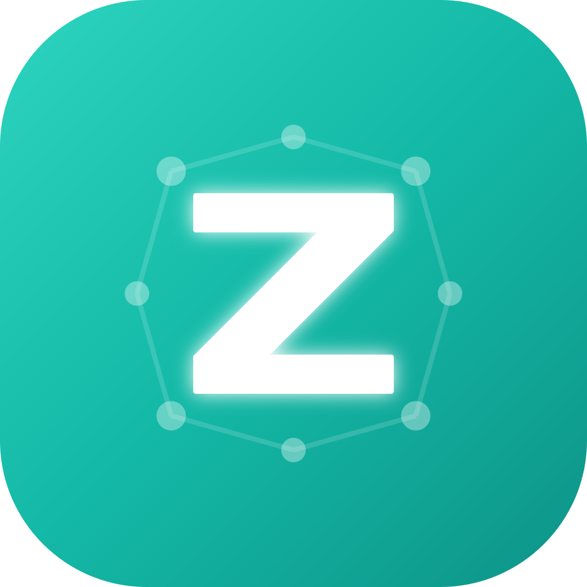

> **言語:** [English](README.md) | 日本語

<p align="center">
  
</p>

<h1 align="center">Zedi</h1>

<p align="center">
  <strong>Zero-Friction Knowledge Network</strong><br />
  思考を宇宙のように拡張する、AIネイティブなナレッジアプリ
</p>

<p align="center">
  <a href="#features">Features</a> •
  <a href="#demo">Demo</a> •
  <a href="#getting-started">Getting Started</a> •
  <a href="#tech-stack">Tech Stack</a> •
  <a href="#roadmap">Roadmap</a> •
  <a href="#contributing">Contributing</a>
</p>

<p align="center">
  
  
  
</p>

---

## 🌟 Overview

**Zedi** は、「書くストレス」と「整理する義務」からあなたを解放するナレッジアプリです。

従来のメモアプリでは、情報をフォルダに分類し、手動でリンクを作成する必要がありました。Zedi は AI による足場生成（Scaffolding）と WikiLink によるネットワーク構造で、思考を自然に拡張させます。

### 💡 デザイン原則

- **Speed & Flow** — 起動0秒、保存不要。思考の速度で書ける
- **Context over Folder** — フォルダ不要。時間とリンクで自然に整理
- **Atomic & Constraint** — 1ページ1アイデア。小さく繋げる
- **Scaffolding by AI** — AIが知識の足場を自動生成
- **Dormant Seeds** — 未整理のメモも「発芽待ちの種」として許容

---

## ✨ Features

### 📅 Date Grid

日付ごとにグループ化されたページをグリッド表示。「いつ何を書いたか」が一目瞭然。

### 🔗 WikiLinks

`[[ページタイトル]]` 記法で簡単にページ間リンク。オートコンプリート付きで既存ページにすばやくアクセス。

### 🤖 AI Wiki Generator

キーワードを選択して AI に解説を生成させると、関連トピックへのリンクも自動挿入。知識のネットワークが自動的に広がります。

### 🌐 Web Clipper

URL を入力するだけで Web ページの本文を自動抽出。あとから自分のペースでキーワードをリンク化できます。

### 🔍 Global Search

`Cmd+K` / `Ctrl+K` で全文検索を起動。キーワードを含むページを瞬時に発見。

### 🔀 Linked Pages

ページ下部に関連ページを自動表示：

- **Outgoing Links** — このページからリンクしている先
- **Backlinks** — このページにリンクしている元
- **2-hop Links** — リンク先のリンク先まで辿れる

### ⌨️ Keyboard Shortcuts

- `Cmd/Ctrl + K` — グローバル検索
- `Cmd/Ctrl + N` — 新規ページ作成
- `Cmd/Ctrl + H` — ホーム画面へ
- `Cmd/Ctrl + /` — ショートカット一覧

### 📝 Markdown Editor

Tiptap ベースのリッチエディタ。Markdown ショートカットでシームレスに書ける。

- `# ` → 見出し
- `- ` → 箇条書き
- `> ` → 引用
- `**text**` → 太字
- `` ` `` → コードブロック

---

## 🎬 Demo

> 🚧 **Coming Soon** — スクリーンショットとデモ動画を準備中です

<!--
Demo screenshots: place assets under public/ when available. Tracked prose lives in source (TSDoc); optional local docs/ is gitignored — see AGENTS.md.
-->

---

## 🚀 Getting Started

### 前提条件

- [Bun](https://bun.sh/) v1.0 以上（必須）
- [Node.js](https://nodejs.org/) v24 以上（任意。CI・一部スクリプトで使用。`.nvmrc` / `engines.node` 参照）

### クイックスタート

```bash
# リポジトリをクローン
git clone https://github.com/otomatty/zedi.git
cd zedi

# 初回セットアップ（依存関係 + Git hooks + 検証 + エージェントミラー）
bun run init

# 開発サーバーを起動
bun run dev
```

### 手動セットアップ

```bash
git clone https://github.com/otomatty/zedi.git
cd zedi
bun run init
bun run dev
```

ブラウザで http://localhost:30000 を開いてください（デフォルトポート）。

### ポート設定

複数のアプリを並列で開発する場合、ポートを変更できます：

```bash
# 方法1: 環境変数で指定
VITE_PORT=30001 bun run dev

# 方法2: .env.local ファイルを作成
echo "VITE_PORT=30001" > .env.local
bun run dev
```

ポートが使用中の場合は、自動的に次の利用可能なポートが使用されます。

### 環境変数の設定（オプション）

旧バックエンド（`server/api`・`server/hocuspocus`・`server/mcp`）は削除済みのため、現行フロントにはサインインや同期の接続先がありません。[.env.example](.env.example) はビルドに必要な値だけを持ちます。作り直したアプリ（`app/`）の設定は `app/.dev.vars` に置きます（[app/README.ja.md](app/README.ja.md) を参照）。

> **Note:** 環境変数なしでもフロント単体はローカルで動作します（一部データは IndexedDB に保存）。AI 機能はアプリの設定画面から各プロバイダの API キーを入力して使用できます。

---

## 🛠 Tech Stack

| Category          | Technology                                                                                               |
| ----------------- | -------------------------------------------------------------------------------------------------------- |
| **Frontend**      | React 19 + TypeScript 6 / React Router v7                                                                |
| **Build Tool**    | Vite 8 (`@vitejs/plugin-react-swc`) / Bun                                                                |
| **Editor**        | Tiptap 3 (ProseMirror) — tables / math (KaTeX) / code (lowlight) / collaboration (Y.js)                  |
| **Styling**       | Tailwind CSS v4 + shadcn/ui (Radix UI primitives) / `next-themes`                                        |
| **State / Data**  | Zustand 5 + TanStack Query 5 / React Hook Form + Zod                                                     |
| **i18n**          | i18next + react-i18next                                                                                  |
| **Visualization** | Recharts / `@xyflow/react` (React Flow) / Mermaid / KaTeX / Tesseract.js (OCR)                           |
| **Auth**          | [Better Auth](https://better-auth.com/) (OAuth / セッション cookie)                                      |
| **Backend**       | `app/`（作り直し中）— Cloudflare Worker 1 本: Hono + Better Auth + D1 (Drizzle) + Durable Objects (Y.js) |
| **Database**      | D1（マイグレーション: `app/migrations/`）/ IndexedDB (local・ブラウザ)                                   |
| **AI**            | OpenAI / Anthropic / Google Gemini（OpenRouter で価格情報を取得）                                        |
| **Admin**         | `admin/` — 別 Vite + React アプリ                                                                        |
| **Workspaces**    | Bun workspaces: `packages/ui`（shadcn）, `packages/shared` / `admin`                                     |
| **Deploy**        | 現在はなし。作り直した `app/` を Cloudflare Worker 1 本としてデプロイする予定（`wrangler deploy`）       |
| **CI/CD**         | GitHub Actions（lint / typecheck / test / mutation）                                                     |
| **Testing**       | Vitest 4 + Testing Library / Playwright / Stryker（Mutation Testing）                                    |
| **Tooling**       | ESLint 9 / Prettier / Husky + lint-staged / commitlint / Knip                                            |

---

## 🗺 Roadmap

### ✅ 完了

- [x] React + Vite 基盤構築
- [x] ページの CRUD 操作
- [x] Date Grid UI
- [x] WikiLink 機能（サジェスト付き）
- [x] AI Wiki Generator
- [x] Web Clipper
- [x] Global Search
- [x] キーボードショートカット
- [x] Better Auth による認証（OAuth / セッション cookie）
- [x] Markdown エクスポート
- [x] Backlinks / 2-hop Links 表示
- [x] Linked Pages カード表示

ロードマップの詳細は Issue / Discussions を参照してください。

---

## 🧪 Testing

```bash
# ユニットテスト
bun run test

# E2E テスト
bun run test:e2e

# テストカバレッジ
bun run test:coverage

# Mutation testing（Stryker; 品質の第一指標は Mutation スコア）
bun run test:mutation:dry
bun run test:mutation
```

品質指標・テスト方針（TDD / Mutation）・仕様の書き方は [AGENTS.md](AGENTS.md) を参照してください。

---

## 📁 Project Structure

Zedi は `app/` で Cloudflare Worker 1 本の構成（hono/jsx/dom、Hono、Better Auth、D1、Durable Objects）に作り直しています。現行アプリの機能が揃ったら `src/`・`admin/` を置き換えます。旧バックエンド（`server/*`）は削除済みです。詳細は [app/README.ja.md](app/README.ja.md)。

```
app/                     # 作り直し中のアプリ（Worker 1 本。ルート workspace 外）
src/                     # フロントエンド本体（React + Vite）
├── components/          # React コンポーネント（editor / page / search / layout / ui ほか）
├── hooks/               # カスタムフック
├── lib/                 # ユーティリティ
├── pages/               # ルートに対応するページコンポーネント（React Router v7）
├── stores/              # Zustand ストア
└── types/               # TypeScript 型定義

packages/                # Bun workspaces（共有ライブラリ）
└── ui/                  # `@zedi/ui` — shadcn/ui ベースの共有 UI コンポーネント

admin/                   # 管理画面アプリ（別 Vite + React + Tailwind / `@zedi/ui` 利用）
terraform/cloudflare/    # Cloudflare 関連インフラ定義
e2e/                     # Playwright E2E テスト
scripts/                 # セットアップ / Stryker / 保守用スクリプト
.github/workflows/       # GitHub Actions（lint / typecheck / test / mutation）
```

---

## 🤝 Contributing

コントリビューションを歓迎します！

1. このリポジトリをフォーク
2. `develop`ブランチから機能ブランチを作成 (`git checkout -b feature/amazing-feature`)
3. 変更をコミット (`git commit -m 'feat: add amazing feature'`)
4. ブランチをプッシュ (`git push origin feature/amazing-feature`)
5. `develop`ブランチに対して Pull Request を作成

詳細は [CONTRIBUTING.ja.md](CONTRIBUTING.ja.md) と [AGENTS.md](AGENTS.md)（ブランチ・PR・マージ方法）を参照してください。

---

## 📄 License

このプロジェクトは **Business Source License 1.1 (BSL 1.1)** の下で公開されています（Source-Available）。商用の競合サービスとしての提供は制限されますが、個人利用・社内利用・改変・再配布は許可されています。初回公開から **4 年後** に [Mozilla Public License 2.0 (MPL 2.0)](https://www.mozilla.org/en-US/MPL/2.0/) へ自動変換されます。詳細は [LICENSE](LICENSE) を参照してください。

---

## 🙏 Acknowledgments

- [Tiptap](https://tiptap.dev/) — エディタフレームワーク（ProseMirror）
- [shadcn/ui](https://ui.shadcn.com/) / [Radix UI](https://www.radix-ui.com/) — UI コンポーネント
- [Y.js](https://yjs.dev/) / [PartyServer](https://github.com/cloudflare/partykit) — リアルタイム共同編集
- [Better Auth](https://better-auth.com/) — 認証（OAuth / セッション cookie）
- [Hono](https://hono.dev/) — API フレームワーク（Cloudflare Workers 上）
- [Drizzle ORM](https://orm.drizzle.team/) — TypeScript ORM
- [Polar](https://polar.sh/) — Pro プランの課金基盤
- [Cloudflare](https://www.cloudflare.com/) — ホスティング

---

<p align="center">
  Made with ❤️ by Saedgewell
</p>
